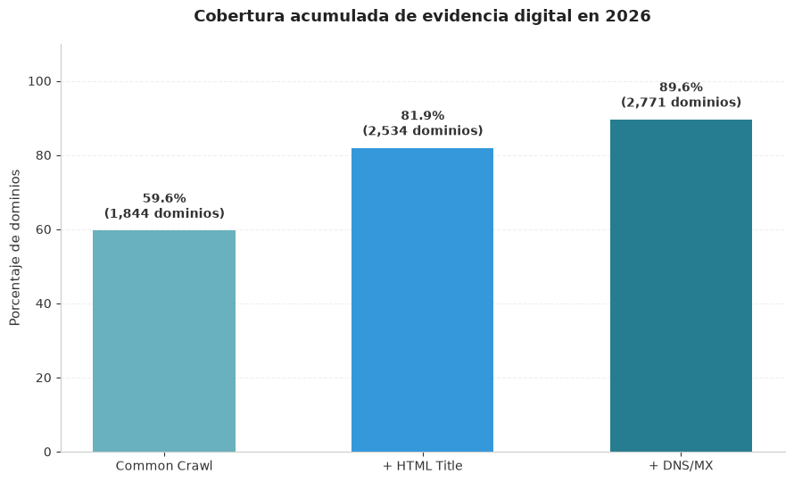

# AI Companies 2 — Exploring Digital Evidence in 2026

**Marcela Zena · Noviembre 2026**

Continuación de [Understanding the 2022 AI Companies Landscape](https://github.com/mastro75/ai-companies-2022).


## La pregunta


En el proyecto anterior, *Understanding the 2022 AI Companies Landscape*, exploré un dataset de empresas que ofrecían servicios de inteligencia artificial en 2022. Analicé su distribución geográfica, sus perfiles y el lugar que ocupaba la IA dentro de su oferta.

De ese análisis del ecosistema de empresas de IA surge una nueva pregunta:

> **¿Qué evidencia digital podemos encontrar en 2026 sobre los dominios de aquellas empresas?**

Este segundo proyecto nace de esa pregunta y busca explorar qué información podemos recuperar al combinar distintas fuentes de evidencia digital.

---

## 💡 El hallazgo principal

Partí de **3.094 dominios únicos** registrados en el dataset de 2022.

La primera búsqueda fue en **Common Crawl**, un archivo público de capturas de páginas web. Allí encontré evidencia para **1.844 dominios (59,6%)**.

¿Y qué pasaba con el resto? **No encontrar una captura no significa necesariamente que un dominio haya desaparecido.**

Por eso amplié la investigación incorporando otras fuentes: **registros DNS/MX**, relacionados con la configuración del correo electrónico, y **títulos de páginas web (HTML Title)**.

| Fuentes consultadas | Dominios con evidencia |
| :--- | :--- |
| Common Crawl | 1.844 (59,6%) |
| + HTML Title | 2.534 (81,9%) |
| + DNS/MX | 2.771 (89,6%) |

Al combinar las fuentes, encontré evidencia digital en **927 dominios adicionales**.



El resultado más interesante no fue descubrir cuántas empresas seguían funcionando, sino **cuánto cambia lo que podemos observar cuando dejamos de depender de una sola fuente**.

---

## 🔍 Qué descubrí

### 1. No encontrar una captura no significa que un sitio haya desaparecido

Common Crawl permitió identificar capturas para el 59,6% de los dominios analizados.

Pero ¿qué significa realmente no encontrar una captura? Para entenderlo, hice una comprobación exploratoria con un sitio conocido: `nytimes.com`.

Aunque se trata de un sitio web conocido, la consulta realizada a Common Crawl no devolvió capturas que cumplieran los criterios utilizados para los dos períodos analizados. **La ausencia de resultados en Common Crawl no demuestra que un sitio haya dejado de existir**.

*Este ejemplo fue una prueba externa al dataset, no una de las empresas analizadas.*

Durante la investigación también encontré páginas que bloqueaban el acceso automatizado, errores técnicos y dominios en venta. **No todas las respuestas negativas significan lo mismo.**

### 2. Las herramientas también tienen limitaciones: el caso del análisis semántico

Quise explorar qué decían los títulos HTML sobre la actividad de los sitios. Para eso utilicé un diccionario de palabras clave que buscaba referencias a inteligencia artificial, software, consultoría y otros servicios.

Pero al revisar resultados clasificados como *Otros (no clasificado)*, encontré un caso interesante:

> *«IA en producción, dentro de tu operación»*

El título hacía referencia a inteligencia artificial, pero el diccionario no lo reconoció porque no contemplaba `IA` como término independiente. Un detalle pequeño, pero importante para interpretar los resultados. **Automatizar una clasificación no elimina la necesidad de revisar lo que devuelve.**

### 3. Cruzar fuentes permitió encontrar evidencia que antes no veíamos

De los 1.250 dominios sin capturas en Common Crawl, **826 tenían registros MX identificados**. También encontré **690 dominios sin capturas en Common Crawl que sí presentaban un título HTML válido**.

Al combinar las fuentes, la cobertura pasó del **59,6% al 89,6%**.

Estos resultados muestran por qué una sola fuente no alcanzaba para responder la pregunta inicial. El análisis no consistió solamente en recuperar más información. También implicó **entender qué significaba cada señal y dónde seguía existiendo incertidumbre**.

---

## 📊 Explorar los resultados

El notebook incluye visualizaciones para comprender:

- Cómo cambia la cobertura al incorporar nuevas fuentes.
- Qué encontramos al cruzar Common Crawl, HTML Title y DNS/MX.
- Qué diferencias aparecen según la especialización en IA registrada en 2022.
- Cómo se distribuyen algunas de estas evidencias entre países y regiones.
- Qué situaciones técnicas explican algunos resultados inesperados.

👉 **[Explorar el notebook completo](notebooks/AI_Companies_2026_Digital_Evidence.ipynb)**

---

## 🛠️ Cómo lo investigué

El proyecto combinó investigación, análisis de datos y herramientas técnicas. Partí del dataset original de 2022 y fui incorporando fuentes para responder nuevas preguntas.

- **Common Crawl y Amazon Athena:** para consultar capturas web de junio y septiembre de 2026.
- **DNS/MX y HTML Title:** para incorporar señales adicionales.
- **SQLite y SQL:** para integrar resultados y relacionar las fuentes.
- **Python, Pandas y Jupyter:** para explorar los datos y documentar el análisis.
- **Matplotlib, Seaborn y Plotly:** para visualizar los hallazgos.

El proceso no fue lineal. Algunas respuestas abrieron nuevas preguntas y llevaron a revisar resultados, incorporar fuentes y ajustar interpretaciones. **El notebook documenta ese recorrido.**

---

## 🔐 Una decisión sobre los datos públicos

El dataset original de 2022 incluía nombres de empresas y dominios. Para este segundo proyecto **decidí no publicar la relación entre esas empresas y las señales técnicas encontradas en 2026**.

Aunque la información original sea pública, relacionar una empresa con un dominio sin respuesta, con errores técnicos o en venta podría generar interpretaciones equivocadas sobre su situación actual.

Por eso el dataset público utiliza **identificadores internos** en lugar de nombres y dominios. La correspondencia con las empresas originales permanece en el entorno privado de investigación.

---

## 📁 Estructura del repositorio
```text
ai-companies-2026-evidence/
│
├── README.md
├── LICENSE
│
├── notebooks/
│   └── AI_Companies_2_Public.ipynb
│
├── data/
│   ├── AICompanies_unificado_2026.csv
│   └── evidencia_geografica_2026.csv
│
└── images/
    └── visualizaciones y ejemplos del análisis

```

El notebook público contiene el recorrido de la investigación, los cálculos, las visualizaciones y las interpretaciones. Los archivos de datos fueron preparados para la publicación y permiten explorar los resultados sin identificar empresas individuales. La extracción original y la construcción del dataset anonimizado se realizaron en un entorno privado.

## ⚠️ Qué no podemos concluir

Evidencia digital no significa supervivencia empresarial.

Encontrar una captura web, un título HTML o registros MX no confirma que una empresa siga operando, ni que el dominio pertenezca a la misma organización de 2022.

Del mismo modo, no encontrar evidencia en las fuentes consultadas no demuestra que una empresa haya desaparecido.

Las diferencias entre países o segmentos son descriptivas y no permiten establecer relaciones causales.

Este proyecto tampoco representa a todas las empresas de IA existentes en 2026. Su punto de partida es un conjunto histórico específico de empresas registradas en 2022.


## 🚀 Para seguir investigando

El proyecto deja nuevas preguntas abiertas.

¿Qué ocurre con los dominios donde no encontramos evidencia? ¿Cuántos cambiaron de propietario o de actividad? ¿Qué otras fuentes permitirían comprender mejor su evolución?

Son preguntas que este análisis todavía no puede responder. Ese es también uno de sus resultados: entender mejor qué sabemos, qué no sabemos y dónde vale la pena seguir investigando.

---

## 📚 Fuentes y licencia

Este proyecto parte de un dataset histórico publicado en Kaggle, con información procedente de Clutch.co, y utiliza fuentes públicas de evidencia digital.

-**Dataset original 2022:** [AI Companies Dataset (Vineeth Akkinapalli, 2022)](https://www.kaggle.com/datasets/vineethakkinapalli/ai-companies-dataset) - Datos reales extraídos de perfiles de empresa en Clutch.co.
- **Common Crawl:** [commoncrawl.org](https://commoncrawl.org/)

Los datos derivados se publican de forma anonimizada. El uso y la reutilización de los materiales deben respetar las licencias aplicables al código, los datos y las fuentes originales.

**Licencias específicas:**
- **Código:** MIT License (ver archivo `LICENSE`).
- **Datos agregados y anonimizados:** CC BY-NC-SA 4.0.
- **Datos originales de 2022:** pertenecen a Clutch.co / Kaggle y no se redistribuyen.
